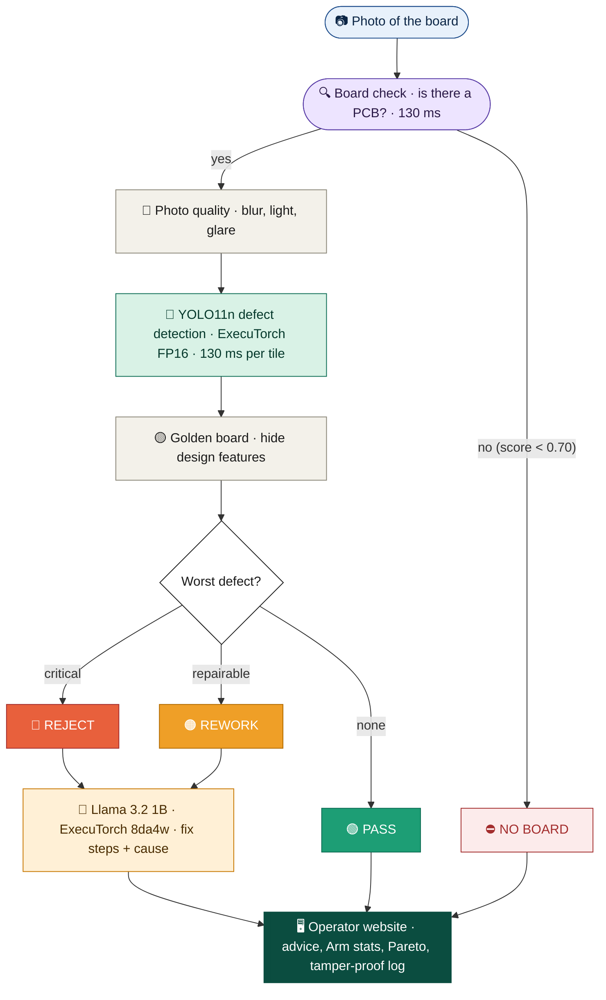

# BoardCheck: on-device PCB defect inspection on Arm

> ### 🏆 ARM Bharat AI-SoC Challenge 2026–27
> **Problem statement 5: Real-time industrial defect detection & quality-control assistant**
>
> | Challenge asks for | BoardCheck |
> |---|---|
> | Real-time defect detection | YOLO11n finds 7 PCB defect types; verdict in about 2 s on the phone |
> | Quality-control assistant | Llama 3.2 1B tells the operator how to fix each defect and the likely process cause |
> | Llama via **ExecuTorch** (mandatory) | Llama 3.2 1B Instruct, 8da4w, ExecuTorch + XNNPACK, with our runtime patch and prefix KV cache |
> | Runs on **Arm** hardware | Android phone, MediaTek MT6886: 2x Cortex-A715 + 6x Cortex-A510. CPU only, offline |
> | Arm optimisation evidence | FP16 / 8da4w models, thread tuning on big.LITTLE, an Arm Performance Studio (Streamline) profile |

A phone on a stand checks bare printed circuit boards. **YOLO11n finds the defects, rules decide PASS / REWORK / REJECT,
and Llama 3.2 1B explains how to fix them.** Everything runs on the phone's Arm CPU with **ExecuTorch**. No cloud and no GPU.
A laptop only shows the operator website.

## How it works



**Where each part runs**

```mermaid
flowchart LR
    subgraph PHONE["📱 Phone · Arm CPU only · ExecuTorch + XNNPACK · offline"]
        direction TB
        CAM["📷 Camera"]:::input --> GATE["🔍 Board check<br/>pcb_gate_v5.pte"]:::gate
        GATE --> YOLO["🧠 YOLO11n v3<br/>pcb_yolo11n_v3_fp16.pte"]:::ai
        YOLO --> RULES["⚖️ Rules + golden board"]:::rule
        RULES --> LLAMA["🦙 Llama 3.2 1B<br/>llama1b_8da4w.pte"]:::llm
    end
    subgraph LAPTOP["💻 Laptop · no AI"]
        direction TB
        BR["🔁 server/bridge.py<br/>WebSocket relay"]:::step --> WEB["🖥️ Operator website"]:::web
    end
    LLAMA == "results + advice<br/>USB / Wi-Fi" ==> BR
    WEB -. "inspect, thresholds,<br/>golden board" .-> CAM

    classDef input fill:#E8F1FB,stroke:#1F4E8C,color:#0B2545
    classDef gate fill:#EDE4FF,stroke:#5B3FA8,color:#2B1A47
    classDef ai fill:#D9F2E6,stroke:#0F6E56,color:#06392C
    classDef llm fill:#FFF0D6,stroke:#C77700,color:#4A2C00
    classDef rule fill:#FFFFFF,stroke:#1A1A1A,color:#1A1A1A
    classDef step fill:#F3F1EA,stroke:#8A8678,color:#1A1A1A
    classDef web fill:#0B4D40,stroke:#0B4D40,color:#FFFFFF
```bash
pip install websockets
python3 server/bridge.py          # then open http://localhost:8000
```

**Android app** (Android Studio's JDK + SDK; arm64 phone, Android 9+)
```bash
android/build.sh install          # builds BoardCheck-debug.apk and installs it with adb
```
The models are not packed into the APK. Copy them to the app's private folder:
```bash
adb push ml/models/pcb_yolo11n_v3_fp16.pte ml/models/pcb_gate_v5.pte /data/local/tmp/
adb shell run-as com.boardcheck.app mkdir -p files/models
adb shell run-as com.boardcheck.app cp /data/local/tmp/pcb_yolo11n_v3_fp16.pte /data/local/tmp/pcb_gate_v5.pte files/models/
```
Llama: export Llama 3.2 1B Instruct with ExecuTorch's LLM export (XNNPACK, 8da4w, KV cache), then copy
`llama1b_8da4w.pte` and `tokenizer.json` to `files/models/` the same way. The weights are not in this repository
(Llama 3.2 Community License; the file is about 1 GB).

Connect over USB with `adb reverse tcp:8765 tcp:8765` and **Connect → USB link** in the app, or scan the QR code
shown on the website's Settings page.

**Test without a camera:** `adb shell am start -n com.boardcheck.app/.MainActivity --es image files/test/<name>.jpg`
inspects a stored photo with the same pipeline (`--ez no_cache true` always runs Llama, `--ez pin_big true` pins to the big cores).

**Profile:** `profiling/capture.sh <name> <seconds> <test images…>` records a Streamline capture.
`profiling/analyze.py <report dir>` summarises it per stage.

## Limits

- Bare boards only (no assembled boards: components, solder joints).
- Recall on yellow bare-copper boards (PCB-Defect) and DsPCBSD+ is about 0.54. PKU trace junctions can read as shorts unless a golden board is set.
- Measured on one phone. Throttling during long runs on USB charge slows YOLO by up to 2×.

## Third-party code, models and data

- [ExecuTorch](https://github.com/pytorch/executorch) (BSD-3-Clause), with the patch in `android/executorch_android/`.
- Arm Streamline annotation library in `android/native/annotate/` (BSD-3-Clause, © Arm Limited; see its `LICENSE`).
- [Ultralytics YOLO11](https://github.com/ultralytics/ultralytics) (AGPL-3.0). It was used to train the detector, and the trained weights are derived from it.
- Llama 3.2 1B Instruct (Llama 3.2 Community License). Built with Llama.
- Datasets (not included; see `ml/data_prep/`): PKU-Market-PCB, DeepPCB, DsPCBSD+, PCB-Defect v2, DefectDet. Each has its own licence.
