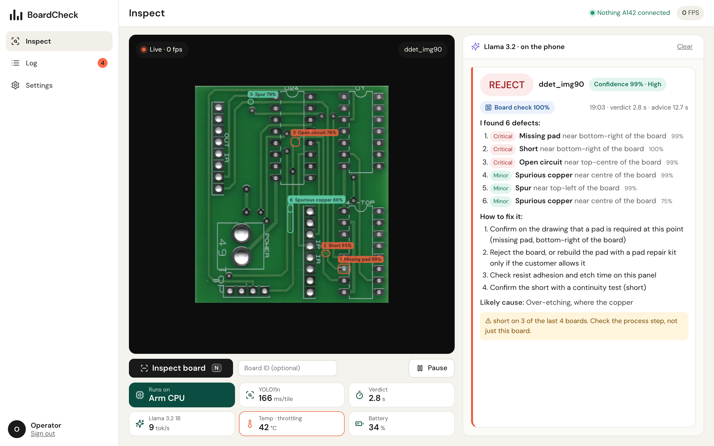
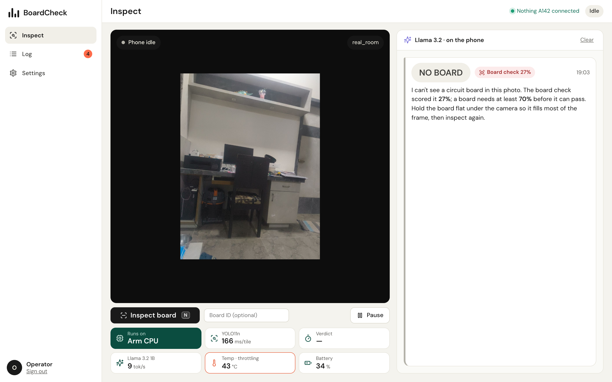
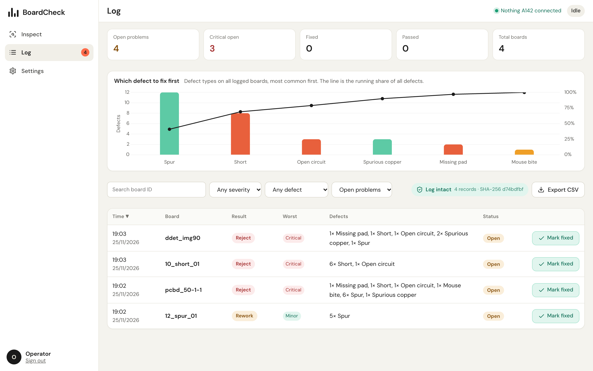
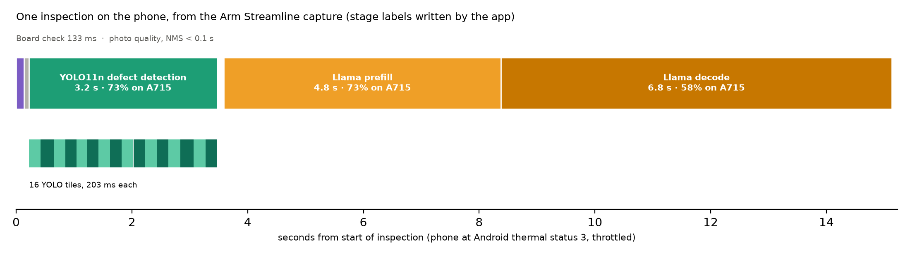

# BoardCheck: on-device PCB defect inspection on Arm

> ### 🏆 ARM Bharat AI-SoC Challenge 2026–27
> **Problem statement 5: Real-time industrial defect detection & quality-control assistant**
>
> | Challenge asks for | BoardCheck |
> |---|---|
> | Real-time defect detection | YOLO11n finds 7 PCB defect types; verdict in about 2 s on the phone |
> | Quality-control assistant | Llama 3.2 1B tells the operator how to fix each defect and the likely process cause |
> | Llama via **ExecuTorch** (mandatory) | Llama 3.2 1B Instruct, 8da4w, ExecuTorch + XNNPACK, with our runtime patch and prefix KV cache |
> | Runs on **Arm** hardware | Android phone, MediaTek MT6886: 2x Cortex-A715 + 6x Cortex-A510. CPU only, offline |
> | Arm optimisation evidence | FP16 / 8da4w models, thread tuning on big.LITTLE, an Arm Performance Studio (Streamline) profile |

📄 **Final project report:** [docs/BoardCheck_Final_Report.pdf](docs/BoardCheck_Final_Report.pdf)

A phone on a stand checks bare printed circuit boards. **YOLO11n finds the defects, rules decide PASS / REWORK / REJECT,
and Llama 3.2 1B explains how to fix them.** Everything runs on the phone's Arm CPU with **ExecuTorch**. No cloud and no GPU.
A laptop only shows the operator website.

| ⏱️ Verdict | 🎯 Real-board defects | 🚫 Not a board | 🦙 Llama on CPU | 📴 Cloud |
|:---:|:---:|:---:|:---:|:---:|
| **~2 s** per board | **P 0.86 · R 0.77** (DefectDet, held out) | **45 / 45** rooms & desks rejected | **9–11 tok/s** | **none**, fully offline |



## Screens

<table>
<tr>
<td width="50%"></td>
<td width="50%"></td>
</tr>
<tr>
<td><b>Not a board:</b> a room photo scores 27 % on the board check and is answered with NO BOARD, never PASS.</td>
<td><b>Log:</b> Pareto chart of defect types, a SHA-256 hash-chained log ("Log intact"), CSV export.</td>
</tr>
</table>

## What it does

| | |
|---|---|
| **Defects** | missing hole, mouse bite, open circuit, short, spur, spurious copper, missing pad |
| **Verdict** | rule-based from defect severity (never from the LLM): any critical → REJECT, only repairable → REWORK, none → PASS |
| **Advice** | Llama 3.2 1B writes the fix steps and likely cause. Each reply is checked against a repair guide (SOP), with a rule-based fallback |
| **Trust** | board check (a desk or room is "No board", never PASS), calibrated confidence, photo-quality check, golden reference board |
| **Traceability** | board ID from a QR sticker, a log protected by a SHA-256 hash chain, CSV export, Pareto chart of defect types |

## Arm / ExecuTorch work

- **YOLO11n → ExecuTorch FP16 with the XNNPACK delegate** (`ml/export_v3.py`, 10 MB). The `.pte` matches PyTorch on held-out boards (P 0.880 / R 0.748 vs 0.880 / 0.752).
- **Llama 3.2 1B Instruct → ExecuTorch 8da4w** (8-bit dynamic activations, 4-bit weights, XNNPACK, KV cache).
- **ExecuTorch runtime patch** (`android/executorch_android/boardcheck-threads.patch`, rebuilt `libexecutorch.so`). On a chip with only 2 big cores, the stock runtime left Llama one thread. The patch lets the app set the thread count. The app also keeps a **prefix KV cache**: the fixed system prompt is prefilled once, and each board only prefills its own findings.
- **Thread counts measured on the phone** (`ml/results/phone/yolo_bench.json`, `llama_threads*.json`): 2 threads is best for this 2 + 6 core chip. For example, the FP32 YOLO takes 192 ms/tile with 2 threads and 313 ms/tile with 6.
- **Arm Performance Studio / Streamline profile** ([`profiling/FINDINGS.md`](profiling/FINDINGS.md)). The app labels every stage in Streamline's timeline through Arm's annotation library (`android/native/annotate`). Findings: 27–42 % of inference cycles ran on the A510 cores (IPC ≈ 0.7–0.9 vs 2.3–2.9 on the A715). Llama decode is memory-bound (42 % back-end stalls). Thermal throttling is the biggest factor on this phone. A big-core pinning option (`Affinity.kt`) is built in, and its benefit still has to be measured on a cool phone.



## Results

### Defect detection (YOLO11n v3, held-out data)

| Test set | Boards | Precision | Recall | Old model (P / R) |
|---|---|---|---|---|
| DefectDet (real photos, green) | held-out half | **0.86** | **0.77** | 0.00 / 0.00 |
| PCB-Defect v2 (real photos, yellow) | held-out designs | **0.87** | 0.54 | – / 0.00 |
| DeepPCB (scans) | full test set | 0.89 | **0.91** | 0.05 / 0.00 |
| DsPCBSD+ | full test set | 0.83 | 0.54 | 0.00 / 0.00 |
| PKU-Market-PCB | held-out half | 0.72 | **0.95** | 0.81 / 0.94 |

Thresholds per class are tuned on one half and reported on the other half (`ml/results/phaseB_final.json`).
On PKU, most false alarms are trace junctions read as "short". The **golden board** check cuts them from
140 to 61 at recall 0.95 → 0.935 (`ml/golden_eval.py`, `ml/results/golden_eval.json`).

**Confidence calibration** (isotonic, 238 boards, 2 339 detections): average gap between stated and real accuracy
0.164 → **0.031** (`ml/calibrate_v3.py`, `web/js/calibration.json`).

### Board check ("is there a circuit board?")

| Held-out test | Result |
|---|---|
| Room video frames + a room photo that used to PASS | **45 / 45 rejected** (highest score 0.18; a PASS needs ≥ 0.70) |
| Real phone board frames | 17 / 17 accepted |
| DefectDet green boards / green-board video | 44 / 44 · 37 / 37 accepted |
| PCB-Defect yellow boards | 38 / 42 accepted |
| On the phone (`results/phone/v5_gate_phone.json`) | room → NO BOARD (0.27); 8 / 8 test boards accepted (0.95–1.00) |

### Speed on the phone (MT6886, CPU only)

| Stage | Time |
|---|---|
| Board check | ~130 ms |
| YOLO11n per 640 px tile (FP16, 2 threads) | ~130 ms cool · 180–290 ms when the phone throttles |
| Verdict for a full photo (12–16 tiles) | ~2.2 s |
| Llama prefill, board findings (~160 tokens, prefix cached) | 46–55 tok/s |
| Llama decode | 8.5–11 tok/s |

## Repository

| Path | What it is |
|---|---|
| `android/app/` | Android app (Kotlin): camera, `Detector.kt`, `PcbGate.kt`, `Golden.kt`, `Advisor.kt` / `QcAdvisor.kt` (Llama + SOP), `Annotate.kt` / `Affinity.kt` (Streamline labels, big-core pinning) |
| `android/executorch_android/` | ExecuTorch Android library with the thread-count patch and the rebuilt `libexecutorch.so` |
| `android/native/annotate/` | JNI wrapper around Arm's Streamline annotation library (`build.sh` builds `libbcannotate.so`) |
| `server/bridge.py` | Serves the website and relays phone ↔ website over WebSocket (no AI on the laptop) |
| `web/` | Operator console: Inspect (live view, Llama chat, Arm performance strip), Log (Pareto chart, hash-chained log, CSV), Settings (thresholds, golden board, confidence) |
| `ml/` | Training and evaluation: `train_v2.py`, `augment.py` (phone-look augmentation), `train_gate.py`, `eval_v2.py`, `golden_eval.py`, `calibrate_v3.py`, `export_v3.py`, phone test harnesses |
| `ml/data_prep/` | Builds the merged dataset (PKU + DeepPCB + DsPCBSD+ + PCB-Defect v2 + DefectDet), crops real boards from video, mines hard negatives |
| `ml/models/` | Final models: `pcb_yolo11n_v3_fp16.pte`, `pcb_gate_v5.pte` |
| `ml/runs/pcb_yolo11n_v3/` | Final training run: metrics, curves, `best.pt` |
| `ml/results/` | Every evaluation, calibration and phone test as JSON |
| `profiling/` | Streamline capture / analysis scripts, counter config, findings |

## Run it

**Website (laptop)**
```bash
pip install websockets
python3 server/bridge.py          # then open http://localhost:8000
```

**Android app** (Android Studio's JDK + SDK; arm64 phone, Android 9+)
```bash
android/build.sh install          # builds BoardCheck-debug.apk and installs it with adb
```
The models are not packed into the APK. Copy them to the app's private folder:
```bash
adb push ml/models/pcb_yolo11n_v3_fp16.pte ml/models/pcb_gate_v5.pte /data/local/tmp/
adb shell run-as com.boardcheck.app mkdir -p files/models
adb shell run-as com.boardcheck.app cp /data/local/tmp/pcb_yolo11n_v3_fp16.pte /data/local/tmp/pcb_gate_v5.pte files/models/
```
**Llama** (not in this repository: Llama 3.2 Community License, and the file is about 1 GB). Accept the licence on
Hugging Face, then export it with optimum-executorch. We used optimum-executorch 1.1.0 with ExecuTorch 1.6.0. These options
match our model; the log of our export is `ml/llm/export_8da4w.log`.
```bash
pip install executorch==1.6.0 optimum-executorch==1.1.0
optimum-cli export executorch --model meta-llama/Llama-3.2-1B-Instruct --task text-generation \
  --recipe xnnpack --use_custom_sdpa --use_custom_kv_cache --qlinear 8da4w --output_dir ml/llm/pte_8da4w
adb push ml/llm/pte_8da4w/model.pte /data/local/tmp/llama1b_8da4w.pte
adb shell run-as com.boardcheck.app cp /data/local/tmp/llama1b_8da4w.pte files/models/
```
Copy the model's `tokenizer.json` to `files/models/` the same way. Linear layers are 8da4w (8-bit dynamic activations,
4-bit weights) and the embeddings stay unquantized, which gives a ~0.96 GB `.pte`.

Connect over USB with `adb reverse tcp:8765 tcp:8765` and **Connect → USB link** in the app, or scan the QR code
shown on the website's Settings page.

**Test without a camera:** `adb shell am start -n com.boardcheck.app/.MainActivity --es image files/test/<name>.jpg`
inspects a stored photo with the same pipeline (`--ez no_cache true` always runs Llama, `--ez pin_big true` pins to the big cores).

**Profile:** `profiling/capture.sh <name> <seconds> <test images…>` records a Streamline capture.
`profiling/analyze.py <report dir>` summarises it per stage.

## Limits

- Bare boards only (no assembled boards: components, solder joints).
- Recall on yellow bare-copper boards (PCB-Defect) and DsPCBSD+ is about 0.54. PKU trace junctions can read as shorts unless a golden board is set.
- Measured on one phone. Throttling during long runs on USB charge slows YOLO by up to 2×.

## Third-party code, models and data

- [ExecuTorch](https://github.com/pytorch/executorch) (BSD-3-Clause), with the patch in `android/executorch_android/`.
- Arm Streamline annotation library in `android/native/annotate/` (BSD-3-Clause, © Arm Limited; see its `LICENSE`).
- [Ultralytics YOLO11](https://github.com/ultralytics/ultralytics) (AGPL-3.0). It was used to train the detector, and the trained weights are derived from it.
- Llama 3.2 1B Instruct (Llama 3.2 Community License). Built with Llama.
- Datasets (not included; see `ml/data_prep/`): PKU-Market-PCB, DeepPCB, DsPCBSD+, PCB-Defect v2, DefectDet. Each has its own licence.
